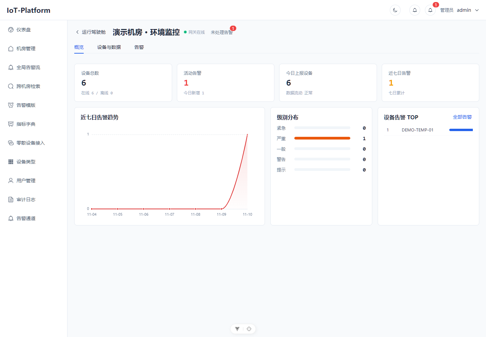
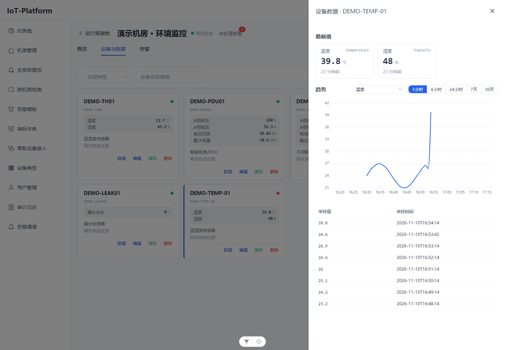
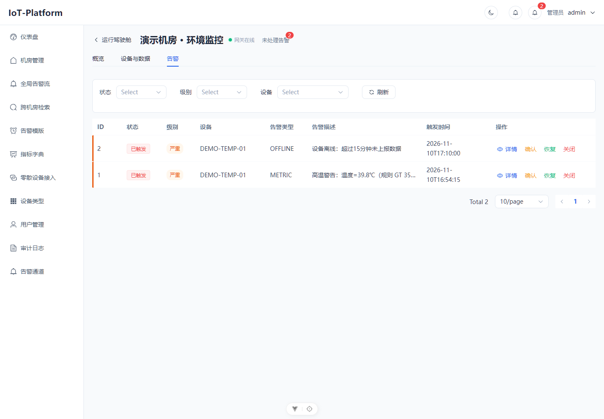

# DCIM · 数据中心动环监控平台

围绕机房、设备和测点，接收网关采样、查看指标历史，并按规则触发和处理告警。配套仿真器可以生成虚拟设备与网关数据，供个人开发和联调使用。

**个人项目 · Java / Spring Boot + Vue 3 · 同仓独立仿真器**

本项目使用 AI 编码工具开发，由旧物联网项目迭代为单租户动环平台。当前展示源码、自动化检查和隔离环境联调记录；没有真实机房生产运行结论。

[本地启动](docs/70_部署运行/本地开发与仿真联调.md) · [本轮验证](docs/50_系统测试/2026-11-10-仓库收口验证.md) · [仿真器](simulator/README.md) · [项目总控](docs/00_总控.md)

## 看一条数据怎样进入平台

机房创建接入凭证 → 仿真器网关轮询虚拟设备 → HTTP 上报 → 设备与测点登记 → 最新值/历史查询 → 阈值告警 → 人工处理与状态留痕。

### 机房概览

按机房查看在线设备、近期上报、活动告警及分布。

### 设备数据

最新值、时间窗口内的指标趋势与采样明细在同一抽屉中查看。

### 告警处理

查看阈值与离线告警；记录确认、处理、恢复和关闭过程。

三张图片来自 2026-11-10 实际运行界面与合成数据，拍摄时间不同；来源和局限见 [图片索引](docs/assets/showcase/README.md)。

## 已实现的主要能力

| 部分 | 实现范围 |
|---|---|
| 机房与设备 | 机房管理、设备类型、指标绑定、满足规则时首包自动登记 |
| 数据接入 | 统一采样核心；HTTP/MQTT 签名通道及 token/子凭证入口；已有字段路径映射与未匹配原始报文留存 |
| 测点数据 | 最新值、历史查询、时间分桶、月分区与保留策略 |
| 告警 | 类型/设备绑定模板，阈值评估，级别与状态流转、处理记录 |
| 账户与通知 | 单租户 ADMIN/OPERATOR/VIEWER，JWT、操作审计，站内/WebSocket 及外部通知渠道实现 |
| 仿真器 | 温湿度、UPS、PDU、空调、漏水五类预设；虚拟 Modbus TCP 设备、网关轮询与 HTTP/MQTT 上报 |

**接入范围**：符合统一上报契约的设备可通过配置接入；已有映射能力可处理其支持的字段结构。特殊协议、新数据结构或新增计算行为仍可能需要网关或平台适配，不能泛化为“新增任何设备类型都不用改代码”。平台本体不承担现场南向协议采集。

## 工程结构与阅读入口

| 目录/入口 | 内容 |
|---|---|
| [src/](src/) | Spring Boot 4.0.6、MyBatis-Plus、Flyway、MySQL、Redis |
| [frontend/](frontend/README.md) | Vue 3、Vite、Element Plus、Pinia、ECharts |
| [simulator/](simulator/README.md) | 独立 Spring Boot 进程与 Maven 构建；JPA + MySQL 独立库 |
| [采样核心](src/main/java/com/example/platform/ingest/service/impl/IngestCoreServiceImpl.java) | 入口归一、身份/归属检查、去重与入库 |
| [趋势查询](src/main/java/com/example/platform/service/impl/MetricSampleServiceImpl.java) | 采样明细与分桶历史 |
| [告警评估](src/main/java/com/example/platform/service/impl/AlarmEvaluateServiceImpl.java) | 模板与阈值评估 |
| [告警状态](src/main/java/com/example/platform/service/impl/AlarmEventServiceImpl.java) | 确认、处理、恢复、关闭与留痕 |

网关签名 HTTP 入口为 `POST /api/ingest/samples`。当前签名计算为 `sha256(secret + 原始 JSON 正文)`，按实现对接，不将它描述为标准 HMAC 算法。

## 如何运行

需要 JDK 17、Maven、Node.js 22.12+ 或兼容版本、MySQL 9.6、Redis 7。具体建库、变量与三个进程的命令见 [本地开发与仿真联调](docs/70_部署运行/本地开发与仿真联调.md)。

| 进程 | 默认地址 | 说明 |
|---|---|---|
| 平台后端 | http://localhost:8080/api | 健康检查 /api/actuator/health；dev 文档 /api/swagger-ui.html |
| 前端 | http://localhost:5173 | 由 Vite 启动，/api 转发至后端 |
| 仿真器 | http://localhost:8090 | 独立启动；MySQL 独立库 dcim_simulator_db |

[docker-compose.yml](docker-compose.yml) 编排 app、mysql、redis、mosquitto；**不含前端与仿真器**。本轮已校验配置并修正健康端点与容器服务地址，未完成 Compose 整体启动验证。

## 2026-11-10 验证摘要

| 检查 | 结果 |
|---|---|
| 平台 Maven verify | 394 项，392 通过、2 条件跳过，0 失败/错误 |
| 仿真器 Maven verify | 79 项通过，构建成功 |
| 前端 | 17 项测试通过，生产构建通过 |
| 本地 HTTP 联调 | 仿真器上报、平台最新值/历史查询、阈值触发及人工状态流转通过 |
| 展示页面 | 真实浏览器采集，未发现页面脚本错误 |

两项平台跳过测试均依赖未配置的邮箱账户；不计为通过。仿真器观测截点为 236 次 HTTP 请求、236 成功、0 失败，属于本地链路检查，不能作为容量压测结论。完整证据与命令见 [验证记录](docs/50_系统测试/2026-11-10-仓库收口验证.md)。

本轮未验证真实机房、真实硬件、MQTT 端到端、外部通知投递、生产部署或长期稳定性；系统测试/部署阶段与 B2/B3/N/T 遗留任务按总控继续跟踪。

## 维护

main 保存本轮检查过的源码；后续变更使用短期任务分支。提交围绕实际改动组织，保留旧项目与重构历史，见 [开发与提交约定](docs/90_全局/开发与提交约定.md)。

旧首页与交接材料见 [历史索引](docs/archive/repository-showcase-20261110/INDEX.md)。许可证保持现状，本轮未添加或更改授权条款。
